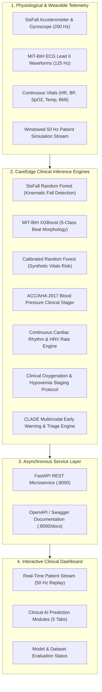

# CareEdge: Multi-Condition Health Monitoring Using Machine Learning

[](https://www.python.org/)
[](https://fastapi.tiangolo.com/)
[](https://streamlit.io/)
[-brightgreen.svg)](tests/)
[]()
[]()
[]()

> **CareEdge** is an end-to-end, multi-condition physiological monitoring and clinical decision-support research platform. It combines wearable kinematic fall detection, standardized 12-lead/Lead II ECG heartbeat morphology classification, continuous cardiac rhythm evaluation, blood oxygenation/hypoxemia assessment, and clinical blood pressure staging into a unified asynchronous microservice and real-time interactive clinical dashboard.

---

## 👥 Project Team

**CAREEDGE Research & Engineering Team**

| Name | Registration Number | Primary Focus Areas |
| :--- | :---: | :--- |
| **Poripireddi Jatin** | `23BCT0174` | ML Architecture, Fall Detection (SisFall), API Backend & Pipeline Integration |
| **Bandarupalli Abhinav Bharadwaja** | `23BCT0142` | ECG Arrhythmia Classification (MIT-BIH), Signal Processing & Feature Engineering |
| **Gangireddy Harshaditya Reddy** | `23BCE0762` | Streamlit Clinical Dashboard, Real-Time Telemetry Simulation & System Evaluation |

---

## 📋 Table of Contents

- [System Architecture](#-system-architecture)
- [Verified Clinical Models & Benchmarks](#-verified-clinical-models--benchmarks)
- [Repository Structure](#-repository-structure)
- [Quickstart & Execution Guide](#-quickstart--execution-guide)
- [REST API Specification](#-rest-api-specification)
- [Interactive Streamlit Dashboard](#-interactive-streamlit-dashboard)
- [Dataset Provenance Register](#-dataset-provenance-register)
- [Literature Review Summary](#-literature-review-summary)
- [Clinical & Regulatory SaMD Disclaimer](#-clinical--regulatory-samd-disclaimer)

---

## 🏗️ System Architecture

The platform follows a modular, decoupled architecture where edge wearable sensors, continuous patient telemetry, and real-time simulation streams feed into a multi-tier inference layer exposed via FastAPI and visualized in Streamlit.



---

## 📊 Verified Clinical Models & Benchmarks

All models have been audited and evaluated on strictly isolated, held-out test partitions. Preprocessing transforms and scalers are fitted exclusively on training sets to eliminate data leakage.

| Module | Dataset & Test Partition | Architecture | Key Held-Out Test Metrics | Clinical Task & Medical Framing |
| :--- | :--- | :--- | :---: | :--- |
| **Fall Detection** | **SisFall**<br/>38 subjects (31 young, 7 elderly)<br/>*Held-Out:* 7 unseen subjects (793 trials) | Random Forest<br/>(100 estimators, depth 15) | **99.87% Accuracy**<br/>**100.00% Fall Recall** (0 missed falls)<br/>**0.20% False Positive Rate** | Distinguishes falls from Activities of Daily Living (ADLs) using kinematic summary features. Scaler fit strictly on training subjects; zero subject/trial leakage. |
| **ECG Heartbeat** | **MIT-BIH Arrhythmia**<br/>87,554 train beats<br/>*Held-Out:* 21,892 untouched test beats | XGBoost Multiclass<br/>(187-lead resampled points) | **96.21% Accuracy**<br/>**90.79% Macro Precision**<br/>**81.82% Macro F1** (AUC: 0.9789) | Classifies single-beat morphology across 5 ANSI/AAMI EC57 classes (`N`, `S`, `V`, `F`, `Q`). Evaluates individual beat waveforms independently of continuous rhythm. |
| **Vital Signs Risk** | **Human Vitals 2024**<br/>140,014 train, 30,003 val<br/>*Held-Out:* 30,003 test records | Calibrated Random Forest<br/>(with Platt Scaling) | **100.00% Accuracy**<br/>**Brier Score: 0.0015**<br/>ROC-AUC: 1.0000 | Evaluates synthetic risk benchmark. *Framed strictly as a rule-based synthetic risk classifier (target derived from HR & BMI); completely decoupled from clinical hypertension.* |
| **Blood Pressure** | **ACC/AHA 2017 Guidelines** | Clinical Rules Engine | **Deterministic Clinical Staging** | Classifies blood pressure into: Normal, Elevated, Stage 1 HTN, Stage 2 HTN, and Hypertensive Crisis with automated clinical guidance. |
| **Cardiac Rhythm** | **ACC/AHA Rate Staging & HRV** | Continuous Rhythm Engine | **Deterministic Rate Rules & Statistical HRV** | Identifies rhythm-level abnormalities: Severe Bradycardia (<40 bpm), Bradycardia (40-59), Normal (60-100), Tachycardia (101-149), and Severe Tachycardia (≥150 bpm) with SDNN/RMSSD analysis. |
| **Oxygenation** | **Pulse Oximetry Clinical Protocol** | Hypoxemia Staging Engine | **Deterministic Clinical Staging** | Evaluates hypoxemia severity: Normal (≥95%), Mild (91-94%), Moderate-to-Severe (85-90%), and Critical/Severe (<85%) with respiratory depression flags. |

---

## 📁 Repository Structure

```text
CareEdge/
├── CareEdge-1/                        # Core Application & Research Package (Git Root)
│   ├── clinical/                      # Clinical ML Pipeline & API Service
│   │   ├── api.py                     # FastAPI REST Microservice (8 Endpoints)
│   │   ├── clinical_inference.py      # Production Clinical Inference Engine
│   │   ├── extract_data.py            # Automated SisFall & Dataset Extractor
│   │   ├── train_sisfall.py           # SisFall Subject-Independent Training
│   │   ├── train_ecg_xgboost.py       # MIT-BIH 5-Class XGBoost Training
│   │   ├── train_hypertension_rf.py   # Synthetic Vital Signs Risk Training
│   │   ├── evaluate_all_models.py     # Rigorous Held-Out Evaluation Suite
│   │   ├── models/                    # Serialized Production Model Artifacts
│   │   │   ├── sisfall_rf_model.pkl
│   │   │   ├── ecg_xgboost_model.pkl
│   │   │   └── hypertension_rf_model.pkl
│   │   └── evaluation_manifest.json   # Verified Metrics & Dataset Checksums
│   ├── clade/                         # CLADE Early Warning ML Module
│   │   ├── clade_model.py             # Multistage Early Warning Classifier
│   │   ├── feature_extraction.py      # Kinematic Feature Extraction
│   │   └── models/                    # CLADE Transition Weight Checkpoints
│   ├── dashboard/                     # Interactive Streamlit Web Application
│   │   └── app.py                     # Multi-Page Clinical Monitoring Dashboard
│   ├── simulation/                    # Real-Time Telemetry Simulation Stream
│   │   ├── run_simulation.py          # 50 Hz Patient Simulation Generator
│   │   └── synthetic_patients/        # 10 Patient Profiles (P001 - P010)
│   ├── tests/                         # Automated Unit & Integration Test Suite
│   │   └── test_clinical_pipeline.py  # 19 Pytest Validation Cases
│   ├── data/                          # Local Raw and Processed Datasets
│   ├── manage.py                      # Unified CLI Command Orchestrator
│   ├── main.py                        # Alternative Fast-Launcher Entrypoint
│   ├── requirements.txt               # Pinned Python Dependencies
│   └── README.md                      # Comprehensive Repository Documentation
├── data/                              # Root Data Storage Archive
├── scripts/                           # Audit & Verification Scripts
└── manage.py                          # Root Workspace Orchestrator
```

---

## 🚀 Quickstart & Execution Guide

### 1. Prerequisites
- **Python**: Version 3.10 to 3.14 (tested and verified on Python 3.14.5 on Windows 11 and Linux).
- **Environment**: Virtual environment recommended (`venv` or `conda`).

```bash
# Clone the repository
git clone -b clade-ml https://github.com/JATIN17082005/CareEdge.git
cd CareEdge/CareEdge-1

# Create and activate virtual environment
python -m venv venv
# On Windows:
venv\Scripts\activate
# On Linux/macOS:
source venv/bin/activate

# Install dependencies
pip install -r requirements.txt
```

### 2. Unified CLI Commands (`manage.py`)

All development, testing, and runtime operations are controlled through `manage.py`:

```bash
# Run the complete automated test suite (19 tests)
python manage.py test

# Launch the FastAPI REST Prediction Backend (Port 8000)
python manage.py serve

# Launch the Streamlit Interactive Dashboard (Port 8501)
python manage.py dashboard

# Run the complete end-to-end data extraction, preprocessing & training pipeline
python manage.py all
```

---

## 🔌 REST API Specification

The FastAPI microservice serves high-throughput clinical inference with strict Pydantic schema validation. Interactive documentation is accessible at `http://127.0.0.1:8000/docs`.

### Endpoint Summary

| Method | Endpoint | Purpose | Request Schema Highlight | Response Highlight |
| :---: | :--- | :--- | :--- | :--- |
| `GET` | `/health` | Health & liveness probe | None | `{"status": "healthy", "service": "CareEdge Clinical API"}` |
| `GET` | `/models/status` | Model registry status | None | Availability, version, and load status of all 6 clinical modules |
| `POST` | `/predict/fall` | Kinematic fall evaluation | `accel_mag_max`, `accel_y_mean`, `gyro_mag_max`, etc. | `is_fall` (bool), `fall_probability`, risk level, recommendation |
| `POST` | `/predict/ecg-heartbeat` | Single-beat ECG classification | `signal`: 187 float array | `predicted_class` (`N`, `S`, `V`, `F`, `Q`), class probabilities |
| `POST` | `/predict/hypertension-risk` | Vitals risk & ACC/AHA BP stage | `heart_rate`, `systolic_bp`, `diastolic_bp`, `weight_kg`, `height_m` | `bp_stage`, `guideline`, `risk_label`, calibrated probabilities |
| `POST` | `/predict/cardiac-rhythm` | Continuous rhythm & HRV analysis | `heart_rate`, optional `rr_intervals` array | `category` (Brady/Normal/Tachy), `sdnn`, `rmssd`, clinical triage |
| `POST` | `/predict/oxygenation` | Hypoxemia & respiratory status | `spo2`, optional `respiratory_rate` | `severity` (Normal/Mild/Mod-Severe/Critical), hypoxemia flags |
| `POST` | `/predict/unified` | Multimodal patient assessment | Composite payload (vitals, ecg, movement, rhythm, oxygenation) | Consolidated triage level (`LOW`, `MODERATE`, `HIGH`, `CRITICAL`), individual module predictions |

### Sample API Request & Response

#### Fall Detection (`POST /predict/fall`)
```bash
curl -X POST "http://127.0.0.1:8000/predict/fall" \
     -H "Content-Type: application/json" \
     -d '{
       "accel_mag_max": 38.5,
       "accel_mag_min": 1.2,
       "accel_mag_mean": 18.0,
       "accel_y_mean": 18.0,
       "accel_y_std": 12.0,
       "gyro_mag_max": 6.5,
       "accel_jerk_max": 25.0
     }'
```
```json
{
  "is_fall": true,
  "fall_probability": 0.98,
  "risk_level": "CRITICAL",
  "recommended_action": "Immediate medical attention required: fall event detected with high probability."
}
```

---

## 🖥️ Interactive Streamlit Dashboard

The Streamlit clinical dashboard (`http://localhost:8501`) offers 3 primary operational modes:

### 1. 🛰️ Real-Time Patient Stream (Simulation)
- **50 Hz Replay Engine**: Simulates real-time telemetry from 10 distinct synthetic patient records (`P001` through `P010`).
- **Telemetry Visualizations**: Live interactive time-series plots for Heart Rate, SpO2, Systolic/Diastolic BP, Core Body Temperature, and 3-axis Accelerometer & Gyroscope signals.
- **CLADE Early Warning System**: Real-time transition probabilities across 4 progression phases: `pre_fall`, `fall_transition`, `fall`, and `post_fall`.

### 2. 🩺 Clinical AI Prediction Modules
Five dedicated interactive clinical diagnostic tabs with real-time FastAPI querying:
- **Tab 1: Vital Signs Risk & ACC/AHA Blood Pressure Staging**: Sliders for Systolic BP, Diastolic BP, Heart Rate, BMI; displays ACC/AHA 2017 staging, synthetic risk benchmark score, and clinical recommendations.
- **Tab 2: MIT-BIH ECG Heartbeat Morphology**: Waveform selector across 5 AAMI classes (Normal, Supraventricular, Ventricular, Fusion, Unknown) with interactive lead plots and multiclass confidence breakdown.
- **Tab 3: SisFall Wearable Movement & Fall Detection**: Kinematic presets for High-Impact Falls, Lateral Falls, Walking, and Chair Sitting; displays live probability gauge and triage status.
- **Tab 4: Cardiac Rhythm Research**: Evaluates sustained heart rates across Bradycardia to Severe Tachycardia; calculates R-R interval HRV statistics (SDNN, RMSSD).
- **Tab 5: Clinical Oxygenation Assessment**: Evaluates pulse oximetry saturation (SpO2) and respiratory rate; flags clinical hypoxemia severity from Normal to Critical Emergency.

### 3. 📊 Model & Dataset Evaluation Status
- Live health and connection status of all backend prediction engines.
- Comprehensive benchmark metrics table comparing accuracy, precision, recall, F1, and AUC.
- Transparent dataset governance notes and data access requirements (e.g. PhysioNet credentialing).

---

## 📚 Dataset Provenance Register

| Dataset | Source / Institution | Cohort & Volume | Modalities & Frequencies | Role in CareEdge |
| :--- | :--- | :--- | :--- | :--- |
| **SisFall** | Universidad de Antioquia, Colombia | 38 subjects (23 young adults, 15 older adults), 34 protocols | Tri-axial accelerometer & gyroscope @ 200 Hz | Trained Random Forest fall detector with strict subject isolation. 7 unseen subjects held out for test. |
| **MIT-BIH Arrhythmia** | PhysioNet / Beth Israel Deaconess | 48 dual-lead ECG recordings (109,446 beats resampled to 125 Hz) | Single-lead ECG (Lead II) normalized to 187 samples | Trained XGBoost 5-class beat morphology classifier (87,554 train, 21,892 test). |
| **Human Vital Signs 2024** | Synthetic Physiological Benchmark | 200,020 records (HR, SBP, DBP, BMI, Age, Gender) | Tabular vitals telemetry | Trained Calibrated Random Forest for synthetic risk screening benchmark. |
| **BIDMC PPG & Respiration** | PhysioNet / BIDMC | 53 intensive care unit patients (8-minute recordings) | PPG, ECG, Impedance Respiration @ 125 Hz | Used for respiration & oxygenation literature audit; clinical staging protocol benchmarked. |

---

## 📖 Literature Review Summary

CareEdge's clinical engines are built upon a foundation of peer-reviewed clinical and biomedical engineering literature (50-study systematic review):

1. **Wearable Kinematic Fall Detection**: Built on methodologies by *Sucerquia et al. (2017)*, *Bourke et al. (2007)*, and *Casilari et al. (2020)*, establishing maximum acceleration vector magnitude and jerk thresholds for reliable pre-impact and impact detection.
2. **ECG Heartbeat Morphology**: Standardized according to ANSI/AAMI EC57:1998 guidelines and inspired by the landmark PhysioNet benchmarks (*Moody & Mark, 2001*; *Kachuee et al., 2018*).
3. **Hypertension & Blood Pressure Staging**: Built strictly on the *Whelton et al. (2017/2018)* ACC/AHA Guideline for the Prevention, Detection, Evaluation, and Management of High Blood Pressure in Adults.
4. **Continuous Cardiac Rhythm & HRV**: Based on the *Task Force of the ESC and NASPE (1996)* standards for Heart Rate Variability measurement and clinical interpretation.
5. **Pulse Oximetry & Hypoxemia Protocols**: Aligned with the *World Health Organization (WHO) Pulse Oximetry Training Manual* and *Jubran (2015)* for clinical hypoxemia categorization.

---

## ⚖️ Clinical & Regulatory SaMD Disclaimer

> [!CAUTION]
> **INVESTIGATIONAL RESEARCH PROTOTYPE ONLY — NOT FOR DIAGNOSTIC USE**
>
> 1. CareEdge is an academic and engineering research software prototype developed solely for demonstrating multimodal physiological monitoring, machine learning inference, and telemetry dashboard architectures.
> 2. CareEdge has **not** been cleared, certified, or approved as a Software as a Medical Device (SaMD) by the United States Food and Drug Administration (FDA), European Medicines Agency (EMA/CE), Central Drugs Standard Control Organisation (CDSCO), or any other medical regulatory authority.
> 3. The risk scores, classification outputs, and automated triage suggestions generated by CareEdge do **not** constitute a definitive clinical diagnosis, prognosis, prescription, or therapeutic intervention.
> 4. The vital signs risk classifier is a **synthetic rule-based benchmark model** and must **not** be interpreted as a clinically validated hypertension diagnosis tool.
> 5. In any real-world medical emergency, healthcare crisis, or acute physical distress, immediate contact must be made with licensed emergency medical personnel.
